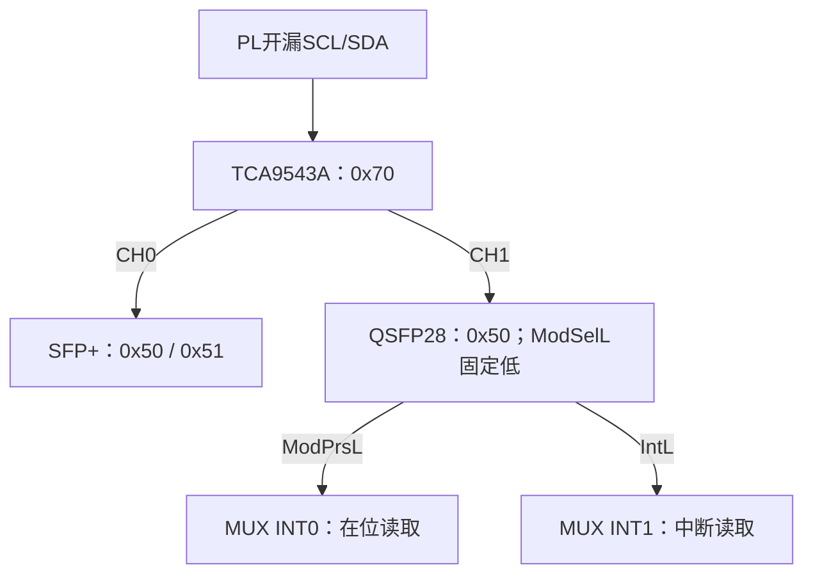

# ZU47DR载板QSFP28 100G电路设计

版本：V1.1｜日期：2026-11-06

本次更新：补充I²C用途、使用/不使用两种电路、混合管理配置、互斥装配和免管理模块验收；原完整电路默认对应方案A，方案B的管理/选择脚以第3.7节覆盖。

## 1. 设计目标与推荐配置

单口QSFP28，面向4×25.78125 Gb/s NRZ主机电接口的100GbE光模块，例如SR4、CWDM4和LR4。仅使用PL的SCL、SDA两个普通IO管理SFP+与QSFP28，QSFP28的ModSelL、ResetL、LPMode以硬件电阻固定，ModPrsL和IntL用于本地指示及I²C间接读取。

默认方案：

- ModSelL：0 Ω接地，永久选中模块的管理接口。
- ResetL：4.7 kΩ上拉，默认释放复位；保留手动复位测试点/按钮。
- LPMode：0 Ω接地，硬件请求正常功率运行；软件仍按模块功率等级授权。
- ModPrsL：10 kΩ上拉，经单通道施密特反相器驱动黄色ABSENT灯。
- IntL：10 kΩ上拉，经单通道施密特同相缓冲器驱动黄色ATTN灯。
- 管理总线：TCA9543APWR两通道I²C开关，CH0接SFP+，CH1接QSFP28，任何时刻只打开一个通道。
- TCA9543A的INT0、INT1分别读取QSFP28的ModPrsL与IntL，不占PL状态输入IO。

本文件包含完整功能网络接线、选型和计算，不是已完成GTY通道仿真与机械核验的PCB制造文件。核心板实际GTY引出管脚、速率等级、已有隔直电容和PL Bank VCCO未提供，相关连接以功能网络定义，落板前必须核实。

## 2. 标准和文献依据

| 资料 | 本设计用途 |
|---|---|
| SFF-8665 | QSFP28整体方案与相关规范索引 |
| SFF-8679 Rev1.9，2025-04-21 | 38触点、电源、低速信号电气与时序 |
| SFF-8636 Rev2.12，2026-04-29 | 本文件采用的管理接口、状态及控制寄存器 |
| IEEE 802.3及所用光模块标准/MSA | 100G主机电气及SR4/LR4/CWDM4等光学要求 |
| AMD DS889、UG578、PG203 | ZU47DR资源、GTY、UltraScale+集成100G Ethernet子系统 |
| IEC 60073:2002 | 指示灯颜色的通用语义参考 |
| TI TCA9543A、SN74LVC1G14/17数据手册 | I²C地址隔离、门限、驱动和封装 |
| Nexperia BC847B及ROHM DTC/DTA144E手册 | 普通/数字三极管候选 |

SFF-8636与CMIS不是同一个寄存器接口。本文件不覆盖采用CMIS的特殊模块、QSFP-DD、QSFP56或单/双通道PAM4主机接口。不能只看外壳能插入就认为模块可直接使用。QSFP28模块内可以存在不同的光学实现，载板仍按四通道NRZ主机接口设计。

所有滤波值、LED电流、布线控制目标和电源余量均为工程设计选择；文末链接用于核对接口要求，不代表这些元件值均由标准强制指定。

## 3. SFP+和QSFP28共存时I²C如何处理

### 3.0 I²C的作用及能否省去

I²C是管理接口，不传输100G以太网帧。四组GTY负责高速数据；SCL/SDA负责识别、诊断及模块设置。不能用“两根I²C线传不了100G”推断其无用，也不能用“GTY有数据”推断模块功率和初始化必然正确。

| 管理功能 | 典型内容 | 不使用后的影响 |
|---|---|---|
| 模块识别 | 型号、厂家、管理版本、功率等级 | 不能自动检查模块能力及适配性 |
| 诊断监测 | 温度、电压、各通道光功率和偏置 | 无法读取实时诊断值 |
| 状态管理 | 初始化完成、LOS、Tx Fault、中断源 | 只能观察硬件ATTN等综合状态，无法区分原因/清除部分事件 |
| 功能配置 | 功率许可、软Tx Disable、可选CDR等 | 只能依赖上电默认设置与固定控制脚 |

本设计提供两种互斥电路：A使用I²C，推荐默认；B完全不用I²C，只针对已验证的固定模块。方案A在两端口都管理时只占2个PL普通IO；方案B不占普通管理IO，但不能保证任意QSFP28插入均工作。第3.1～3.6适用于A，第3.7为B，第3.8处理混合装配。

### 3.1 地址冲突与三种方案

| 设备 | 常用7位地址 | 说明 |
|---|---|---|
| SFP+ | 0x50 | 基本信息 |
| SFP+ | 0x51 | 支持时提供诊断信息 |
| QSFP28，SFF-8636 | 0x50 | 下半区和分页上半区管理空间 |
| TCA9543A | 0x70，A1=A0=0 | 通道开关本身 |

传统A0h/A2h是含读写位的地址表达，对应7位0x50/0x51。QSFP28的分页不是把地址改成0x51。两只模块直接并联时，QSFP28被选中后会与SFP+在0x50冲突。

| 接法 | PL普通IO | 评价 |
|---|---:|---|
| 两组独立I²C | 4 | 最直接，但多两个IO |
| 共用I²C，以GPIO控制QSFP ModSelL | 至少3 | 必须在SFP事务前可靠取消QSFP选择；硬件固定ModSelL低时不能这样用 |
| 一组I²C＋TCA9543A | 2 | 本设计默认；通道通过I²C寄存器选择 |

仅将QSFP28的ModSelL拉高并与SFP共用总线，会使QSFP管理接口始终不可访问，不是可用的双模块管理方案。

### 3.2 推荐拓扑

选用TCA9543A，而不只使用模拟开关，原因是其内部通道选择由同一I²C完成，并且两个INT输入可作为低速状态输入读取。这里的INT0/INT1不控制通道；它们只是被采样的低有效输入。

### 3.3 U10：TCA9543APWR完整连接

| Pin | 名称 | 连接 |
|---:|---|---|
| 1 | A0 | GND |
| 2 | A1 | GND |
| 3 | RESETn | 10 kΩ上拉到VCCO_I2C；设TP_MUX_RST；可用常开按钮接地 |
| 4 | INT0n | QSFP_PRSn，即J2 Pin27 |
| 5 | SD0 | SFP_SDA，接SFP Pin4 |
| 6 | SC0 | SFP_SCL，接SFP Pin5 |
| 7 | GND | GND |
| 8 | INT1n | QSFP_INTn，即J2 Pin28 |
| 9 | SD1 | QSFP_SDA，接QSFP Pin12 |
| 10 | SC1 | QSFP_SCL，接QSFP Pin11 |
| 11 | INTn | 不接PL；不使用时输出悬空，不与其他输出短接 |
| 12 | SCL | PL_SCL |
| 13 | SDA | PL_SDA |
| 14 | VCC | VCCO_I2C，默认1.8/2.5/3.3 V中实际使用的Bank电压 |
| C100 | 去耦 | Pin14到Pin7，100 nF，就近放置 |

VCCO_I2C必须在该开关1.65～5.5 V工作范围内；1.2 V Bank不使用本接法。上游SCL/SDA各4.7 kΩ上拉到VCCO_I2C；CH0两线各4.7 kΩ上拉到3V3_SFP；CH1两线各4.7 kΩ上拉到3V3_QSFP。每段只保留一组上拉，不与之前SFP电路中的上拉重复并装。

TCA9543A支持利用通道MOS开关及各侧独立上拉实现电平转换。用其VCC限制Vpass，必须按手册Vpass最大曲线及供电容差核对：Vpass不高于最低总线电压，开关自身输入门限也必须满足。对于本设计的1.8/2.5/3.3 V同电压上游供电方案，可作为起始配置，不再串联一个PCA9306。不能把该开关以3.3 V供电、上游接任意低压IO而不检查Vpass。

INT0/INT1为耐高压输入，模块状态可按各自3.3 V域上拉；仍需核对上电/掉电输入容差。ModPrsL与IntL各自的10 kΩ上拉也供U10状态输入使用，不另加第二组10 kΩ。

### 3.4 通道控制及状态读取

TCA9543A控制寄存器不需要寄存器偏移地址，直接写一个控制字节：

| 写入值 | 行为 |
|---|---|
| 0x00 | 两个下游通道均断开 |
| 0x01 | 仅CH0，访问SFP+ |
| 0x02 | 仅CH1，访问QSFP28 |
| 0x03 | 两个同时接通；本设计禁止，因0x50地址冲突 |

每次通道选择写入后必须完成STOP，再访问模块。不能把通道选择和模块事务塞在一个没有STOP的组合事务里。软件应对“选通道→模块操作→关闭/释放通道”整段加互斥锁，避免并发线程在事务间换通道。

读取0x70控制字：bit4反映INT0输入的中断状态，bit5反映INT1；输入低时对应位为1，输入高时为0。故bit4=1表示QSFP模块插入，bit5=1表示QSFP IntL低。不要将读回bit4/5的逻辑反过来。上电和复位后通道位为0，但状态位按实际输入反映，不保证整个读回字节始终等于0x00。

开关RESET只复位开关、断开通道，不复位QSFP模块。若已接通的模块将SDA持续拉低，主机也可能无法写0x00来切断它。先尝试允许的总线恢复；失败时通过TP_MUX_RST/按钮复位开关，必要时复位或断电模块。完全没有额外异步控制线，就不能保证软件对所有“总线被拉死”情况自行恢复。将I²C GPIO扩展器放同一被拉死总线上，也不能自动消除这个限制。

### 3.5 上拉电阻和电流计算

起始100 kHz。RC上升时间近似t_r≈0.8473RC；4.7 kΩ、100 pF时约398 ns。用示波器测开关接通后的两侧波形，电容包括连接器、模块、开关、走线和探头。

400 kHz时，SFF-8679在100 pF条件给出上拉最大3 kΩ。因此若升级400 kHz，可先用2.7 kΩ重算并验证，不能把4.7 kΩ在100 pF条件直接当成已满足400 kHz。

通道接通时两侧上拉都可能流向当前下拉端。例如上游1.8 V、下游3.3 V，各4.7 kΩ，按VOL=0.4 V估算：I≈(1.8−0.4)/4.7k＋(3.3−0.4)/4.7k＝0.915 mA；两侧都是3.3 V时约1.234 mA。若改2.7 kΩ，两侧3.3 V时约2.148 mA，加入电源/阻值容差和开关压降后须仍满足模块3 mA下灌条件和主机能力。

两个通道不能同时开，不仅是地址冲突，同时还会叠加更多上拉电流。I²C必须开漏，PL只拉低/高阻释放，并回读SCL以支持模块时钟拉伸。

### 3.6 方案A：使用I²C时的接线和功能

按3.3的U10完整接线：SFP用CH0、QSFP用CH1；每端口两线各4.7 kΩ上拉自身3.3 V，主机两线各4.7 kΩ上拉VCCO_I2C。ModSelL保持0 Ω接地；ResetL 4.7 kΩ上拉；LPMode 0 Ω接地。ModPrsL/IntL仍接本地灯，并接U10的两个INT输入。

软件须执行第11节的初始化和按需功率许可；使用I²C不意味着每次启动都必须修改全部寄存器。先读能力和默认值，只对需要的功能进行读改写。默认LPMode低可以覆盖常见低功耗模块的硬件模式请求，但较高功率授权依然按模块声明处理。

如果只装一个需管理的QSFP28，或者SFP明确不接主总线，则没有两个0x50设备同时应答的问题，可以省U10：PL Bank=3.3 V时SCL/SDA经33 Ω直连，模块侧各4.7 kΩ上拉3V3_QSFP；低压Bank时用与配套SFP文档第10.2节相同的PCA9306连接，模块侧改接QSFP Pin11/12，上拉电源改3V3_QSFP。器件脚号不变，仍需核对电源时序。不要在已有MUX电平转换方案之外无理由再串PCA9306。

### 3.7 方案B：完全不使用I²C的QSFP28电路

**这是固定模块、上电默认可运行的专用方案，不是通用100G QSFP28主机兼容性保证。** 以下连接覆盖第4节默认方案A中管理和选择脚的接法；其余数据、电源及指示灯照原文实施。

| J2信号/元件 | 方案B连接 | 依据与目的 |
|---|---|---|
| Pin11 SCL | 4.7 kΩ上拉3V3_QSFP；保留TP_Q_SCL；不接PL/MUX | 保持空闲高，不产生管理事务 |
| Pin12 SDA | 4.7 kΩ上拉3V3_QSFP；保留TP_Q_SDA；不接PL/MUX | 同上，不固定拉低 |
| Pin8 ModSelL | **R201不装；R202=4.7 kΩ上拉3V3_QSFP** | 管理接口取消选择；不影响高速数据选择 |
| Pin9 ResetL | R203=4.7 kΩ上拉；保留SW201/TP_Q_RST | 默认运行，必要时人工硬件复位 |
| Pin31 LPMode | R205=0 Ω接GND；R206不装 | 请求正常功率，但不能代替软件高功率许可 |
| Pin27 ModPrsL | 保留10 kΩ上拉与ABSENT灯 | 未插模块高，灯亮 |
| Pin28 IntL | 保留10 kΩ上拉与ATTN灯 | 低有效综合中断；不用I²C时可能无法清除 |
| U10 TCA9543A | 两端口都不用管理时不装；所有至本QSFP管理支路断开 | 不使未使用管理脚与其他端口连通 |
| 本QSFP的电平转换器 | 不装 | 管理不接PL，无需电平转换 |
| 四组GTY、参考时钟、三路电源 | 仍按第4、6、7节连接 | 高速链路的必要电路仍保留 |

ModSelL高只禁用/取消选择管理访问，不是关闭100G数据或关闭激光。与方案A的ModSelL接地相反，必须通过BOM表明确区分，不能同时装R201和R202。

以输入最大吸入125 µA保守校核ModSelL上拉：3.135−125µA×4.747k≈2.542 V，超过2.0 V高门限；4.7 kΩ比10 kΩ有更明确的裕量。SCL/SDA上拉为设计的空闲偏置，不将其误称为标准规定的免管理模式。模块输入电流10 µA量级时，4.747 kΩ压降约47.5 mV；实际根据所选模块手册校核。

不把SCL/SDA接地，也不通过未装/未供电的转换器接到PL。无I²C方案中两端口的SCL/SDA应各自独立，即使目前不访问，也不为省布线把两个0x50端口永久并在一起。

需要外接调试器时：先将Pin8可靠拉低并等待规定建立时间，再以3.3 V开漏I²C读写；R202可保留为上拉，调试器/跳帽下拉需承担约0.7 mA及模块内部上拉电流。调试器撤除后释放选择。应预留测试点，不能使用5 V推挽工具；外部调试时实质上已经临时启用了I²C。

#### 方案B的模块资格与功率限制

- 优先选明确支持“无需主机管理写入即可运行”的固定100G模块，并固定厂家、完整型号、固件版本及对端条件。
- 对SFF-8636传统Classes1～4（最高3.5 W），硬件LPMode低且默认控制适合时可作为免管理候选，但仍必须验证；功耗≤3.5 W本身不能保证免初始化。
- 对Classes5～7，不能仅凭本载板电源能提供5 W，就认为无需I²C；软件高功率许可未设置时模块可能被限制且不要求完整工作。未获得厂家明确默认配置说明并实测前，不纳入B方案支持清单。
- Class8及其他特殊功率/管理模块不在本版B方案默认支持范围内。
- 不假设上一轮通过I²C写入的设置会在断电后保存；也不通过私有EEPROM改写冒充标准免管理启动。
- CDR、软禁光和应用选择必须有正确的上电默认值；没有管理接口无法纠正不匹配设置。

#### 无I²C时ATTN灯的特殊解释

模块可能在初始化完成后产生IntL中断，需要主机读标志才能解除。不用I²C时ATTN灯可能长亮，即使100G数据正常，也不能据此认定模块故障；同样不能把灯灭解释为没有任何故障。

方案B推荐保留ABSENT灯；ATTN可保留为中断提示，也可将U202、D202及其限流/去耦DNP以避免误导。无论是否安装灯，IntL的10 kΩ上拉保留。若不装ATTN灯，应在BOM及面板丝印中明确其不装状态，不能让操作人员期待它显示LOS或TX FAULT。

### 3.8 两端口配置与A/B装配差异

| SFP管理 | QSFP管理 | 推荐实际电路 | PL管理IO |
|---|---|---|---:|
| 用 | 用 | U10 CH0/CH1分开，两端口各自上拉；QSFP ModSelL低 | 2 |
| 用 | 不用 | SFP直接/经转换接PL；QSFP按3.7隔离且ModSelL高；U10可省 | 2 |
| 不用 | 用 | SFP本地上拉并隔离；QSFP按3.6单端口管理；U10可省 | 2 |
| 不用 | 不用 | 两端口各自本地上拉、彼此断开；QSFP ModSelL高 | 0 |

| 元件/功能 | A：两端口管理 | B：两端口都不用管理 |
|---|---|---|
| U10及其100 nF去耦 | 装 | 不装 |
| U10 A0/A1及RESET相关装配 | 按3.3装 | 不装；不要把无电U10留在信号路径 |
| 上游PL SCL/SDA上拉 | 装，到VCCO_I2C | 不装，本设计不占该PL IO |
| 模块侧SCL/SDA上拉 | 每端口各装2颗4.7 kΩ | 每端口各装2颗4.7 kΩ |
| 模块到主机/MUX串联连接位置 | 装0 Ω/33 Ω并接到指定通道 | DNP、断开，只留模块侧测试点 |
| QSFP R201/ModSelL下拉 | 装0 Ω | 不装 |
| QSFP R202/ModSelL上拉 | DNP | 装4.7 kΩ |
| ResetL上拉及LPMode下拉 | 装 | 装，不可省略 |
| ModPrsL、IntL状态上拉 | 装 | 装 |
| ATTN灯 | 推荐装，由软件处理事件 | 可DNP；若装需标注可能锁存亮 |
| 高功率授权软件 | 按能力和预算执行 | 无法执行，限制支持模块型号 |

方案B验收至少包括：完全断电再上电、FPGA晚配置、热插拔、人工ResetL复位、长时间双向100G流量、各Lane误码/FEC统计和温度边界测试。用固定型号建立支持清单，不能拿一次链路建立代替全部启动状态验证。

## 4. QSFP28 38触点完整电路

### 4.1 网络命名

3V3_QSFP为经过上游保护的模块端口电源；VCCRX_Q、VCCTX_Q、VCC1_Q为三个滤波支路。QSFP_PRSn、QSFP_INTn分别接Pin27/28。四组主机GTY通道编号为0～3，对应模块Lane1～4。

| Pin | 信号 | 本设计连接 |
|---:|---|---|
| 1 | GND | GND |
| 2 | Tx2n | GTY1_TXN |
| 3 | Tx2p | GTY1_TXP |
| 4 | GND | GND |
| 5 | Tx4n | GTY3_TXN |
| 6 | Tx4p | GTY3_TXP |
| 7 | GND | GND |
| 8 | ModSelL | A：R201＝0 Ω接GND；B：R201不装，R202＝4.7 kΩ上拉，见3.7 |
| 9 | ResetL | R203＝4.7 kΩ上拉3V3_QSFP；TP_Q_RST |
| 10 | VccRx | VCCRX_Q |
| 11 | SCL | A：经U10 CH1接PL；B：仅本地上拉，不接PL/MUX |
| 12 | SDA | QSFP_SDA；A：经U10 CH1接PL；B：仅本地上拉，不接PL/MUX |
| 13 | GND | GND |
| 14 | Rx3p | GTY2_RXP |
| 15 | Rx3n | GTY2_RXN |
| 16 | GND | GND |
| 17 | Rx1p | GTY0_RXP |
| 18 | Rx1n | GTY0_RXN |
| 19 | GND | GND |
| 20 | GND | GND |
| 21 | Rx2n | GTY1_RXN |
| 22 | Rx2p | GTY1_RXP |
| 23 | GND | GND |
| 24 | Rx4n | GTY3_RXN |
| 25 | Rx4p | GTY3_RXP |
| 26 | GND | GND |
| 27 | ModPrsL | QSFP_PRSn；R207＝10 kΩ上拉；接U10 INT0及ABSENT灯输入 |
| 28 | IntL | QSFP_INTn；R208＝10 kΩ上拉；接U10 INT1及ATTN灯输入 |
| 29 | VccTx | VCCTX_Q |
| 30 | Vcc1 | VCC1_Q |
| 31 | LPMode | R205＝0 Ω接GND |
| 32 | GND | GND |
| 33 | Tx3p | GTY2_TXP |
| 34 | Tx3n | GTY2_TXN |
| 35 | GND | GND |
| 36 | Tx1p | GTY0_TXP |
| 37 | Tx1n | GTY0_TXN |
| 38 | GND | GND |

所有GND触点接连续地平面。上表是触点编号，不是从任意视角观察模块金手指所得的排列；封装按连接器厂家顶视/底视图建库。

连接器候选TE 1551920-2；带散热器笼子候选TE 2170704-4。两者是独立物料。核对客户图纸、兼容组合、面板开口、板厚、压接孔和安装工具，勿只依据3D外形判断兼容。若机械结构已有冻结方案，应按实际面板和散热设计调整笼子后缀。

## 5. 控制脚固定电平、计算及能力边界

### 5.1 ModSelL

R201＝0 Ω接地，模块管理接口始终选中。可预留R202＝4.7 kΩ到3V3_QSFP，默认DNP，仅用于装配改选。R201与R202不同时装。

ModSelL不负责开关GTY数据通道，不是发射使能。因为下游I²C已通过U10隔离，保持ModSelL低不会与SFP+冲突。冷启动/热插入后先满足模块初始化和选择建立时间，再开始读寄存器；正常切换U10通道不改变ModSelL电平。

### 5.2 ResetL

R203＝4.7 kΩ上拉到3V3_QSFP，默认不复位。SW201常开按钮连接ResetL与GND；可预留R204＝0 Ω接地位置但默认不装。该按钮只提供人工复位，按模块手册保证有效低脉冲和释放后的初始化等待，建议调试按键保持低至少1 ms，再轮询模块就绪。

为何不默认10 kΩ：用SFF-8679低速输入最大吸入125 µA保守计算，V_H,min＝3.135−125µA×4.747k＝2.542 V，高于2.0 V门限；10.1 kΩ则约1.873 V，若不依赖内部上拉就没有同样的保证。因此本设计选择4.7 kΩ。

ResetL模块内部也有上拉，主机外部上拉提供明确装配状态。模块上电和热插入应自行初始化，不要求主机每次额外产生复位脉冲。ResetL不能固定接地，否则模块持续处于复位状态。

### 5.3 LPMode

R205＝0 Ω接地，默认请求正常功率模式；R206＝4.7 kΩ上拉至3V3_QSFP预留DNP，与R205互斥。模块内部有上拉，不应把LPMode悬空当作允许正常运行。

LPMode低不等于所有模块立即进入完整高功率工作。根据SFF-8636，较高功率等级还需软件设置授权位；软件覆盖也可能使模块保持低功率。低功率不等于标准意义上的“激光必定关闭”。模块软Tx Disable由其他字段控制。

本设计只以传统LPMode含义使用Pin31，不自动将其切换为某些新版本支持的TxDis复用模式。模块选型必须核对其硬件管理接口。

### 5.4 若以后需要远程硬件控制

可以在上游I²C增加GPIO扩展器，通过开漏输出控制ResetL、LPMode或端口电源使能，仍不增加PL普通IO。但这会增加器件和初始化逻辑，且同一总线被拉死时无法保证可用。默认电路不依赖该选配器件。

## 6. 电源与滤波电路

### 6.1 功率预算

以支持最大5 W普通QSFP28光模块作为本版设计目标；更高功耗模块不默认支持。按最低3.135 V：I_total≈5/3.135＝1.595 A。端口3.3 V源建议预留2.5 A连续能力，但每个连接器电源触点的允许电流仍单独受限，不能把2.5 A全部流过其中一个触点。

与SFP+共用上游3.3 V稳压器时，若SFP预留1 A、QSFP预留2.5 A，上游先按至少3.5 A连续能力规划，再加其他3.3 V负载及瞬态余量；若已有模块最大功率，可用真实电流预算替代该预留值。3.5 A不是两个模块正常必然消耗的电流。

### 6.2 三路电源完整接线

| 元件 | 连接/建议条件 |
|---|---|
| C201 | 3V3_QSFP→22 µF→GND |
| C202 | 3V3_QSFP→100 nF→GND |
| FB201 | 3V3_QSFP→磁珠→VCCRX_Q→J2 Pin10 |
| C203/C204/C205 | VCCRX_Q分别经10 µF/1 µF/100 nF到GND |
| FB202 | 3V3_QSFP→磁珠→VCCTX_Q→J2 Pin29 |
| C206/C207/C208 | VCCTX_Q分别经10 µF/1 µF/100 nF到GND |
| FB203 | 3V3_QSFP→磁珠→VCC1_Q→J2 Pin30 |
| C209/C210/C211 | VCC1_Q分别经10 µF/1 µF/100 nF到GND |

三路由同一个电源同时供电，不做三路独立时序。模块内这三路可能任意组合相连，不能假定它们是互相隔离的三个负载。不可用三个独立可调稳压器分别供电造成相互灌电。

磁珠筛选条件：约120 Ω@100 MHz、额定电流≥2 A、DCR≤30 mΩ；按偏置电流下阻抗曲线选择，不只看零偏标称阻抗。大容量电容选10 V、X7R，并核对3.3 V下有效容量；10 µF优先0805/1206，最终按厂家曲线定。100 nF紧邻对应电源/地触点。

上述磁珠滤波是起始工程设计，并不是宣称SFF规范要求唯一采用120 Ω。最终按模块手册及SFF电源噪声测试验证；若滤波产生振铃，需要根据源阻抗与实测加阻尼，不任意堆叠LC。

### 6.3 电压和温升计算

QSFP端口电压目标3.135～3.465 V，包括相应低频纹波、跌落和噪声。若3.3 V源精度±2%，最低3.234 V，仅有99 mV预算覆盖保护器、磁珠、铜线和瞬态。

某支路0.8 A、磁珠30 mΩ：压降24 mV，功耗19.2 mW。若公共电源路径另有50 mΩ且总电流1.6 A，公共压降80 mV，加磁珠后已可能超预算。因此器件电流额定值够用，不代表压降预算合格。

粗略热估算：若模块5 W、期望壳温不超过70℃、入口风温45℃，整个壳体至空气的等效热阻目标≤(70−45)/5＝5℃/W。70℃仅是示例，实际按所购模块壳温等级。选带散热器笼子仍需风量、方向和系统热测试，不能把散热器的存在当作散热已合格。

### 6.4 热插拔和保护边界

3V3_QSFP从载板已有受保护电源分配取得。若没有，应增加端口级限流/短路保护电路，并按模块浪涌和电压预算选定；本文件不把一颗磁珠当成短路保护器。

I_inrush≈C_total×dV/dt。仅有效总电容50 µF、上升时间1 ms时就约165 mA，还需加模块工作电流；模块内部电容和触点反弹会改变峰值。普通软启动负载开关在整机开机时的缓升，不能自动保证插座已经有电之后的每次热插拔浪涌同样受控。应实际插拔验证SFP、QSFP共用源时不会互相复位。

## 7. 100G四通道GTY与时钟

### 7.1 连接与通道编号

| 模块Lane | GTY逻辑编号 | TX+ / TX−脚号 | RX+ / RX−脚号 |
|---:|---:|---|---|
| 1 | 0 | 36 / 37 | 17 / 18 |
| 2 | 1 | 3 / 2 | 22 / 21 |
| 3 | 2 | 33 / 34 | 14 / 15 |
| 4 | 3 | 6 / 5 | 25 / 24 |

主机TX接模块Tx数据输入；模块Rx数据输出接主机RX。推荐一个完整GTY Quad服务QSFP28，另一个可用通道服务10G SFP+。具体采用Bank128还是129，必须以核心板实际引出和CMAC/GT布局规则为准，不在未看原理图、器件位置和IP约束时冻结Bank分配。

ZU47DR具备集成100G MAC/PCS资源，但工程应使用实际器件和Vivado版本创建PG203对应IP，确认可用CMAC/GTY位置、四条25.78125 Gb/s能力、速率等级和时钟路由，并进行一次综合/布局检查。不能拿较早的UltraScale PG165规则替代UltraScale+ PG203及当前器件工具检查。

### 7.2 参考时钟

每条GTY目标25.78125 Gb/s NRZ；100G参考时钟采用IP支持的频率，常用156.25 MHz或322.265625 MHz等配置，必须由当前IP产生的PLL配置验证后确定。本文件以156.25 MHz网络REFCLK_100G_P/N作为设计候选，不宣称所有IP/Quad配置都可无条件使用该频率。

参考时钟进入GTY MGTREFCLK，不进入QSFP28插座。SFP+与QSFP28可以考虑同源，但每个Quad的参考输入、专用时钟共享范围和同时运行的PLL配置需按UG578及IP验证。不要用普通PL差分IO代替MGTREFCLK。

HMC7044的2400 MHz VCO不能整数分频得到156.25 MHz；不能把2400/15当作156.25 MHz。可采用合格的独立差分时钟源或重新设计时钟合成链，按GTY的抖动、电平、共模和耦合要求选型。

### 7.3 AC耦合与通道质量

常规QSFP28光模块的高速输入和输出按模块要求提供内部AC耦合，默认载板不额外串联电容。核心板已有电容、DAC或特殊模块例外必须逐一审查。以实际所购模块数据手册与GTY共模要求为最终依据，不能把“QSFP28外形”当作所有介质均相同的保证。

接口差分通道按100 Ω目标设计；完整链路包括芯片封装、核心板、板间连接器、载板、QSFP连接器。GTY侧终端按IP配置，不在外部再跨接一只100 Ω。若GTY/核心板推荐段采用不同阻抗，应建模验证过渡，而不是把全链路未经分析强制同一几何参数。

对内偏斜可先控制≤1 ps作为工程布线目标；25.78125 Gb/s的UI约38.79 ps，因此1 ps约2.58% UI。四条Lane不要求人为蛇形到完全等长；重点是对内时延、各Lane通道损耗、串扰和PCS允许的Lane间偏斜。所有长度目标最终服从通道仿真。

2U机箱内的核心板连接器是否能支持四条25G是关键检查项。不能仅凭QSFP连接器标称28G，就认定整个核心板到模块通道具备25G裕量。必要时评估低损耗板材、背钻、连接器S参数及IBERT眼图；重定时器应根据通道预算决定，默认不无依据增加。

RS-FEC设置按具体PMD、模块、对端和IP确定，不能一概认为所有100G光模块都需要相同FEC设置。

## 8. 指示灯：颜色、语义及推荐单通道驱动

### 8.1 哪些灯能不用PL IO实现

| 灯 | 颜色建议 | 直接信号 | 点亮条件 |
|---|---|---|---|
| ABSENT | 黄/琥珀；空槽正常时可用白 | ModPrsL | 高：未插模块 |
| ATTN | 黄/琥珀 | IntL | 低：有中断待处理 |
| PWR，可选 | 绿或中性白 | 3V3_QSFP | 接口有电，只表示有电 |
| RX LOS | 黄 | 无独立固定专用脚 | 需读寄存器后驱动LED扩展器等 |
| TX FAULT | 红 | 无独立固定专用脚 | 同上 |
| LINK/ACT | 绿 | CMAC/PCS状态与收发活动 | 需逻辑输出或软件经I²C驱动 |

SFP+和QSFP28的灯不能逐脚照搬：ModPrsL名字低有效，但“未插入时”主机上拉使它高；IntL则是低有效综合中断。SFF没有强制规定本表配色。IEC 60073可提供红=故障、黄=异常/警告、绿=正常的通用语义；它不是QSFP专用灯色规范。IntL可能在初始化完成时拉低，所以ATTN不能标为TX FAULT或简单标成红色故障灯。

### 8.2 单通道驱动默认电路

| 元件 | 选择/连接 |
|---|---|
| U201 | SN74LVC1G14DBVR，施密特反相器，用于ABSENT |
| U202 | SN74LVC1G17DBVR，施密特同相缓冲器，用于ATTN |
| 两颗Pin1 | NC，悬空 |
| 两颗Pin2 A | U201接QSFP_PRSn；U202接QSFP_INTn |
| 两颗Pin3 | GND |
| 两颗Pin4 Y | 分别接D201/D202阴极 |
| 两颗Pin5 | 3V3_QSFP |
| C212/C213 | 各100 nF，Pin5与Pin3之间就近放置 |
| D201阳极 | 3V3_QSFP→RL201＝1 kΩ→黄色LED阳极 |
| D202阳极 | 3V3_QSFP→RL202＝1 kΩ→黄色LED阳极 |
| R207/R208 | QSFP_PRSn/QSFP_INTn各10 kΩ上拉3V3_QSFP |

ABSENT：输入高→反相输出低→LED亮。ATTN：输入低→同相输出低→LED亮。两路看起来只差一个反相泡，不能装成相同器件后还期望相同功能。

LED电流路径统一为3V3_QSFP→限流电阻→LED→逻辑输出→GND。逻辑器件输入只承受状态电平，模块不承担LED电流。每路单独去耦；不用普通非施密特器件随意替换，开漏上拉边沿可能较慢。

### 8.3 电流和电平计算

状态低时按3.465 V、9.9 kΩ上拉算电流上界约0.350 mA，叠加U10与逻辑门输入泄漏后仍应低于SFF-8679规定的2 mA低态测试负载。IntL在10 kΩ上拉条件的高态目标至少Vcc−0.5 V，最低供电下约2.635 V；核对施密特门限并计入额外输入泄漏即可。ModPrsL在位时由模块接地，不存在有源高输出驱动能力需求。

I_LED＝(V_SUPPLY−V_F−V_OL)/R。以低VF黄/琥珀LED的VF典型2.0 V、VOL估算0.1 V、R=1 kΩ：典型1.2 mA。按最高3.465 V、VF最低假设1.7 V、VOL=0、R最低990 Ω，最大约1.78 mA；按最低3.135 V、VF假设2.3 V、VOL保守0.4 V、R=1010 Ω，约0.431 mA。电阻最大功耗约3.15 mW，选0402、1%、≥1/16 W即可。

VF范围是LED筛选条件，不是所有颜色的共同保证值；用0603高效率、低电流下可见度合格的型号。最终用所选LED曲线重算，不用20 mA时亮度代替1 mA时亮度。绿色InGaN器件VF可能较高，电源灯不能不经计算就套用同一阻值。

### 8.4 指示灯真值

| 模块状态 | ABSENT | ATTN |
|---|---|---|
| 未插模块、接口有电 | 亮 | 灭 |
| 已插、无待处理中断 | 灭 | 灭 |
| 已插、初始化完成中断或其他未处理事件 | 灭 | 亮 |

ATTN可能在软件读取并清除标志后熄灭。若软件轮询很快，灯可能只闪很短时间甚至肉眼看不到；它不是故障保持灯。需要保持显示或区分具体故障时，应使用软件锁存状态＋I²C LED驱动器，而不是把模块IntL强行拉住。

## 9. 指示灯普通三极管替代方案

两路极性不同，给出分别适用的连接。与第8节逻辑门互斥装配。

### 9.1 ABSENT：普通NPN低边驱动

Q201＝BC847B；Pin1 B、Pin2 E、Pin3 C按该具体厂家SOT23手册。发射极接地，集电极接LED阴极；LED阳极经2.2 kΩ接3V3_QSFP。QSFP_PRSn经47 kΩ接基极，基极经470 kΩ接地；状态上拉改4.7 kΩ。

名义3.3 V、VBE=0.8 V时，基极支路电流约(3.3−0.8)/(4.7k+47k)=48.36 µA，扣去470 kΩ电流1.70 µA，净基极电流约46.66 µA。LED约(3.3−2.0−0.1)/2.2k=0.545 mA。用强迫β约20的量级进行工程校核，并做全温实测；不把数据手册2 mA、5 V条件下hFE保证直接挪到低电流饱和工作点。

### 9.2 ATTN：普通PNP高边驱动

Q202可选BC857B，必须按实际厂家确认B/E/C脚位。发射极接3V3_QSFP；基极经47 kΩ接QSFP_INTn；基极经470 kΩ接发射极；集电极接LED阳极，LED阴极经2.2 kΩ接GND。IntL仍用10 kΩ上拉，不加下拉。

IntL低时PNP导通而亮灯。3.3 V、模块VOL=0.4 V、VEB=0.8 V时，基极电阻电流约(3.3−0.4−0.8)/47k=44.68 µA；扣去1.70 µA，净约42.98 µA，驱动约0.55 mA LED的量级合理。

模块低态总下灌电流包括上拉与PNP输入支路，约(3.3−0.4)/10k＋44.68µA=0.335 mA。按3.465 V和阻值容差重算仍需小于2 mA。

高态并非数学上恰好等于电源，模块高态允许与电源有压差，温度升高也改变PNP截止情况，所以必须检查ATTN是否微亮。普通PNP没有逻辑施密特门限保证；本文件首选第8节的单通道同相缓冲器。

## 10. 带内置电阻数字三极管替代方案

### 10.1 ABSENT：DTC144EKA

Q203＝ROHM DTC144EKAT146，NPN，内置输入串联R1=47 kΩ、基极到发射极R2=47 kΩ。IN接QSFP_PRSn，GND/发射极接地，OUT接LED阴极；LED阳极经4.7 kΩ接3V3_QSFP；ModPrsL上拉改4.7 kΩ。不再添加外部47 kΩ基极电阻。

名义I_IN≈48.36 µA，内部R2分流0.8/47k=17.02 µA，净基极约31.34 µA；LED典型(3.3−2.0−0.1)/4.7k≈0.255 mA。不同封装的IN/OUT/GND引脚排列可能不同，本方案按功能定义，建库时对应EKA具体封装图。

### 10.2 ATTN：DTA144EKA

Q204＝ROHM DTA144EKAT146，PNP，内置R1=R2=47 kΩ；公共端/发射极接3V3_QSFP，IN接QSFP_INTn，OUT/集电极接LED阳极；LED阴极经4.7 kΩ到GND。IntL保持10 kΩ上拉。

这里内部R2是基极到发射极电阻，等效拉向3.3 V，不能称为“基极到地的下拉”。PNP的公共端不能照搬NPN接地，否则电路方向错误。

3.3 V、VOL=0.4 V、VEB=0.8 V时，I_IN≈(3.3−0.4−0.8)/47k=44.68 µA，内部R2约17.02 µA，净基极约27.66 µA，驱动约0.255 mA低电流LED。模块总下灌约0.335 mA。

### 10.3 公差与保证边界

DTC144E系列手册给出R1=32.9～61.1 kΩ，R2/R1=0.8～1.2；PNP候选也须核对其对应表。不能用“47 kΩ标称”覆盖所有公差，也不能把不满足比例关系的R1/R2极端值随意组合。

例如NPN取R1=61.1 kΩ、R2=48.88 kΩ、上拉4.747 kΩ、电源3.135 V、VBE假设0.9 V：I_IN≈33.94 µA，净基极约15.53 µA；LED最大估算(3.465−1.7)/4.653k≈0.379 mA，所需强迫β约24.4。该结果是工作点工程估算，不是厂家对此工作点的全温饱和压降保证。

ATTN的PNP在高态允许电压差下尤其要检查微亮；数字管的VI(on/off)及GI有特定电流和温度条件，不应直接当作逻辑门的VIH/VIL。数字管方案适合作为少元件、低亮度的候选，量产前实测最小供电、高低温和模块高低态输出极限。不能将DTC/DTA114等低输入电阻型号不经重算直接替换。

| 驱动方案 | ABSENT器件 | ATTN器件 | 电流起始值 | 本设计结论 |
|---|---|---|---|---|
| 单通道施密特 | SN74LVC1G14 | SN74LVC1G17 | 约1.2 mA | 默认推荐，门限最清楚 |
| 普通三极管 | BC847B NPN | BC857B PNP | 约0.55 mA | 可用，需检查增益、截止和温度 |
| 数字三极管 | DTC144EKA NPN | DTA144EKA PNP | 约0.26 mA | 可选，内置电阻省料但仍需验证 |

## 11. I²C软件初始化与功率授权

本节适用于方案A。固定控制脚可以省IO，但需要配置/诊断的模块仍需管理逻辑。方案B不执行本节I²C读写，按第3.7节限制选型并验收，不能假装已经完成高功率许可或标志清除。方案A建议流程：

1. 初始化PL I²C为100 kHz开漏方式，确认上游电平与时钟拉伸处理正常。
2. 向0x70写0x00并STOP；读回状态，使用bit4判断QSFP是否在位。
3. 在位则向0x70写0x02并STOP。按模块上电时间等待并轮询0x50，不能用一次NACK立即判定损坏。
4. 读取模块标识、管理版本、功率等级和能力声明；若不是SFF-8636目标模块，停止套用本文件寄存器流程。
5. 读取下半区byte2的Data_Not_Ready位，等待初始化完成。当前SFF-8636的模块状态、标志及能力须以其版本定义解读。
6. 依据功率等级、板卡5 W预算和散热能力决定是否授权高功率，采用读改写，不整字节盲写byte93。
7. 查询并按需要配置各Lane软件Tx Disable、CDR及其他模块要求的字段；不是所有可选字段都能直接写。
8. 读取并处理初始化中断及相关标志，必要时保存软件副本，再启动CMAC/GTY链路验证。
9. 周期轮询U10状态及模块温度/电压/通道标志；多任务访问通过互斥锁串行切换CH0/CH1。
10. 结束事务后可写0x00关闭通道；若要求实时可读模块，可保留单通道，但应认识到该模块拉死总线的影响。

### 11.1 SFF-8636重要字段

下表偏移均为十进制，寄存器读写地址是7位0x50；不是U10控制寄存器。

| 字段 | 用途与注意 |
|---|---|
| 下半区byte2 bit0 | Data_Not_Ready，初始化完成判定之一 |
| 下半区byte3低4位 | 四路锁存Rx LOS标志，读取语义按标准及模块能力 |
| 下半区byte4低4位 | 四路锁存Tx Fault标志 |
| 下半区byte86低4位 | 四路软件Tx Disable，支持时1禁用、0取消禁用；清零不保证所有其他静噪原因消失 |
| 下半区byte93 bit0 | Power Override，1时用软件Power Set替代LPMode的功率选择 |
| 下半区byte93 bit1 | Power Set，软件覆盖有效时1请求低功率、0请求高功率 |
| 下半区byte93 bit2 | Classes5～7等较高功率许可；按模块声明和版本处理 |
| 下半区byte93 bit3 | 当前版本的Class8授权；本版5 W板卡不自动授权Class8 |
| 上半区page00 byte129 | 扩展标识/功率类别声明，按版本解码 |
| 下半区byte127 | 上半区页选择，支持分页时使用 |

即使LPMode硬件低，byte93高功率许可没设置的高功率模块也可能不能完整运行。对本设计≤5 W模块，在确认属于Classes5～7、且符合电源与散热预算后，才读改写相应授权位。不得固定写0x0D来“兼容所有模块”，否则可能错误允许超出板卡能力的功率或覆盖其他字段。

IntL标志可能具有锁存和读取清除语义。软件轮询应先将原始状态复制到日志/显示，再进行清除，不应让多个线程分别读取同一锁存标志而互相丢失事件。

## 12. PCB、机械和验收

- GTY四条25G保持连续地参考，尽量少过孔、无分叉测试点，长过孔残桩评估背钻。
- 封装焊盘和反焊盘按TE推荐及实际叠层检查，不将旧QSFP+ 10G封装未经评估用于25G。
- 笼子与机壳在面板入口提供短低阻屏蔽回流。模块电源地不应切割以制造所谓“隔离”。
- 高速线上不直接挂普通TVS；若添加保护器，按其25G S参数验证损耗和回损。
- 测试点限于低速与电源：ModSelL、ResetL、LPMode、PRS、INT、SCL/SDA、三路模块电源和MUX RESET。
- 空槽测试：ABSENT亮、ATTN灭；模块插入后ABSENT灭，初始化完成期间ATTN可能亮。
- 同时插SFP与QSFP，验证0x01只看到SFP、0x02只看到QSFP；禁止生产固件写0x03。
- 对拔插、模块复位、MUX复位和总线恢复进行测试，并确认SFP不会被QSFP电源瞬态干扰。
- 分别验证三路触点最大电流、接口最低电压、纹波、热插拔峰值及满功率温升。
- 各Lane做GTY PRBS/IBERT、误码和裕量测试，再运行100G双向流量；检查PCS对齐、FEC统计及对端配置。

## 13. 默认BOM

以下默认BOM为方案A；方案B必须按第3.8节互斥装配表修改，尤其是R201/R202、管理路径连接和U10。模块侧上拉在A/B中都保留，不能因为不装MUX便一并删去。

| 位号/类别 | 型号或条件 | 数量 | 说明 |
|---|---|---:|---|
| J2 | TE 1551920-2候选 | 1 | QSFP28电连接器，按客户图纸核对 |
| 笼子 | TE 2170704-4候选 | 1 | 带散热器，核对机械及风道 |
| U10 | TCA9543APWR | 1 | TSSOP14，I²C通道隔离及状态读取 |
| U201 | SN74LVC1G14DBVR | 1 | ABSENT，反相 |
| U202 | SN74LVC1G17DBVR | 1 | ATTN，同相 |
| R201/R205 | 0 Ω | 2 | ModSelL、LPMode下拉 |
| R202/R206 | 4.7 kΩ，DNP | 2 | 高电平装配选项 |
| R203 | 4.7 kΩ、1% | 1 | ResetL上拉 |
| R204 | 0 Ω，DNP | 1 | 复位调试下拉预留 |
| R207/R208 | 10 kΩ、1% | 2 | PRS、INT上拉，方案A |
| RL201/RL202 | 1 kΩ、1% | 2 | 方案A LED限流 |
| D201/D202 | 高效率0603黄/琥珀LED，按低电流VF和亮度选型 | 2 | ABSENT和ATTN |
| I²C上拉 | 4.7 kΩ、1% | 6 | 上游、SFP支路、QSFP支路各2颗，避免重复装配 |
| MUX RESET上拉 | 10 kΩ | 1 | 到VCCO_I2C |
| C100/C212/C213 | 100 nF、10 V、X7R | 3 | 三颗逻辑器件去耦 |
| SW201及MUX按钮 | 常开瞬时按键或测试点 | 各1 | 可手动恢复，不接PL |
| FB201～203 | 120 Ω@100 MHz、≥2 A、DCR≤30 mΩ | 3 | 核对直流偏置下阻抗 |
| C201 | 22 µF、10 V、X7R | 1 | 核对有效容量 |
| 支路10 µF | 10 µF、10 V、X7R | 3 | 优先0805/1206，按厂家曲线 |
| 支路1 µF | 1 µF、10 V、X7R | 3 | 各电源支路 |
| 电源100 nF | 100 nF、10 V、X7R | 4 | 入口及三支路 |
| 普通管替代 | BC847B＋BC857B | 各1 | 互斥替代U201/U202 |
| 普通管电阻 | 47 kΩ、470 kΩ各2；2.2 kΩ×2 | 1套 | 方案B，ABSENT上拉改4.7 kΩ |
| 数字管替代 | DTC144EKAT146＋DTA144EKAT146 | 各1 | 方案C，不装外置基极电阻，LED改4.7 kΩ |

磁珠、LED及电容的最终厂家料号在确认尺寸、低电流亮度和有效容量后冻结；当前以电气条件选型，不提供未经核实的商城编号。保护电源和参考时钟源为载板共享资源，按全文计算条件设计，不能在未确认上游能力时视为已经满足。

## 14. 落板前需要确定的项目

| 项目 | 原因 | 当前设计处理 |
|---|---|---|
| 核心板GTY具体网络与Bank | 决定通道/CMAC和时钟资源 | 四通道按功能名定义；不虚构BGA脚号 |
| 芯片完整速度等级 | 关系到25.78125 Gb/s能力 | 创建实际Vivado器件工程验证 |
| 核心板耦合电容与B2B通道 | 影响共模及25G损耗预算 | 默认光模块内耦合，需检查现有路径 |
| PL I²C Bank VCCO | 决定U10供电和上游上拉 | 1.8/2.5/3.3 V按实际配置 |
| 最大模块功耗与型号 | 决定授权、保护、风道 | 本版预算≤5 W；不默认支持Class8 |
| 是否要求远程从总线拉死恢复 | 完全无异步IO时有能力限制 | 默认手动MUX复位/模块复位点 |

## 15. 原始参考资料

1. [SNIA SFF-8679，QSFP+ 4X Hardware and Electrical Specification](https://members.snia.org/document/dl/25969)，重点查看6.2～6.6及附录管理时序。
2. [SNIA SFF-8636，Management Interface for 4-lane Modules and Cables](https://members.snia.org/document/dl/26418)，重点查看下半区状态、控制和功率授权表。
3. [SNIA SFF规范索引](https://www.snia.org/technology-communities/sff/specifications)。
4. [NVIDIA MMA1B00-C100D SR4模块管脚及控制说明](https://networking-docs.nvidia.com/mma1b00c100dspec/pin-description)，用作真实100G模块管脚交叉核对。
5. [TI TCA9543A数据手册](https://www.ti.com/lit/ds/symlink/tca9543a.pdf)，重点看PW封装、控制寄存器、INT状态位、Vpass、电压转换及RESET。
6. [TI SN74LVC1G14数据手册](https://www.ti.com/lit/ds/symlink/sn74lvc1g14.pdf)。
7. [TI SN74LVC1G17数据手册](https://www.ti.com/lit/ds/symlink/sn74lvc1g17.pdf)。
8. [Nexperia BC847系列数据手册](https://assets.nexperia.com/documents/data-sheet/BC847X_SER.pdf)。
9. [Nexperia BC857B产品页](https://www.nexperia.com/product/BC857B)，替代装配时从产品页获取当前手册和封装。
10. [ROHM DTC144E数据手册](https://fscdn.rohm.com/en/products/databook/datasheet/discrete/transistor/digital/dtc144ee3-e.pdf)。
11. [ROHM DTA144E数据手册](https://fscdn.rohm.com/en/products/databook/datasheet/discrete/transistor/digital/dta144ee3-e.pdf)。
12. [IEC 60073:2002](https://webstore.iec.ch/en/publication/587)，通用人机界面编码。
13. [Eaton Wiring Manual](https://www.eaton.com/content/dam/eaton/markets/machinebuilding/speed-to-market/wiring-manual/eaton-wiring-manual-mn081007-en-us.pdf)，搜索指示灯颜色语义。
14. [AMD RFSoC产品资源表](https://www.amd.com/en/products/adaptive-socs-and-fpgas/soc/zynq-ultrascale-plus-rfsoc.html)。
15. [AMD DS889，RFSoC Overview](https://docs.amd.com/v/u/en-US/ds889-zynq-usp-rfsoc-overview)。
16. [AMD UG578，GTY用户指南](https://docs.amd.com/v/u/en-US/ug578-ultrascale-gty-transceivers)。
17. [AMD PG203，UltraScale+ Integrated 100G Ethernet](https://docs.amd.com/r/en-US/pg203-cmac-usplus)。
18. [AMD U280参考板QSFP28管理示例](https://docs.amd.com/r/en-US/ug1314-alveo-u280-reconfig-accel/QSFP28-Module-Connector)，其边带通过I²C扩展器管理，作为不直接占FPGA IO的架构参考。
19. [TE 1551920-2](https://www.te.com/en/product-1551920-2.html)。
20. [TE 2170704-4](https://www.te.com/en/product-2170704-4.html)。

